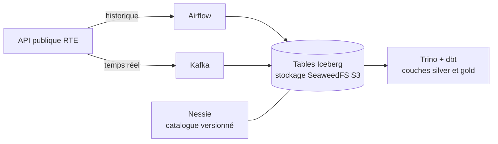

# WattLake

Plateforme Lakehouse open source construite sur les données publiques du mix électrique français (RTE, éCO2mix).

> **Projet en cours**, démarré en novembre 2026. La feuille de route ci-dessous indique ce qui fonctionne déjà et ce qui reste à construire.

## Pourquoi ce projet

WattLake est un projet d'apprentissage : je l'ai lancé pour pratiquer, de bout en bout, une stack Lakehouse moderne (Iceberg, Nessie, Trino, Airflow, Kafka) déployée sur Kubernetes selon des pratiques DataOps.

J'ai choisi les données de production et de consommation électrique parce qu'elles réunissent deux usages classiques : un historique à charger en batch, et des mises à jour fréquentes qui se prêtent à un flux temps réel. Elles permettent aussi de répondre à des questions concrètes, comme l'évolution de la part des énergies renouvelables dans le mix.

## Architecture

Toute la stack tourne sur un cluster Kubernetes local (k3d), déployée avec Helm et, à terme, synchronisée depuis ce dépôt par Argo CD.

| Brique | Outil | Rôle |
| --- | --- | --- |
| Stockage objet | SeaweedFS (API S3) | Stocke les fichiers Parquet des tables |
| Format de table | Apache Iceberg | Organise les fichiers en tables (schéma, partitions, snapshots) |
| Catalogue | Nessie | Versionne l'état des tables, avec des branches comme Git |
| Moteur de requêtes | Trino | Exécute le SQL sur les tables Iceberg |
| Transformations | dbt (adaptateur Trino) | Construit les couches silver et gold, avec des tests |
| Orchestration | Airflow | Planifie l'ingestion batch |
| Streaming | Kafka | Transporte les mises à jour en temps réel |
| Déploiement | Kubernetes, Helm, Argo CD, GitLab CI | Rend la stack reproductible et déployée en GitOps |

## Feuille de route

**Étape 1 : le socle**
- [x] Création du dépôt et de la documentation
- [ ] Cluster k3d et déploiement de SeaweedFS, Nessie et Trino via Helm
- [ ] Première table Iceberg créée depuis Trino et visible dans Nessie
- [ ] DAG Airflow chargeant l'historique dans la couche bronze

**Étape 2 : les transformations**
- [ ] Couches silver et gold avec dbt-trino
- [ ] Tests de qualité des données dans dbt

**Étape 3 : DataOps**
- [ ] CI GitLab : lint, tests Python, tests dbt, construction des images
- [ ] Déploiement GitOps avec Argo CD
- [ ] Write-Audit-Publish : écriture sur une branche Nessie, contrôles qualité, puis fusion dans `main`
- [ ] Identifiants déplacés dans des Secrets Kubernetes

**Étape 4 : temps réel et observabilité**
- [ ] Flux temps réel : API, Kafka, Iceberg
- [ ] Métriques et logs des traitements

## Démarrer

Les instructions d'installation (`make up` / `make down`) seront ajoutées avec l'étape 1.

Prérequis prévus : Docker, k3d, kubectl et Helm.

## Choix techniques

Chaque décision importante est documentée dans un ADR (Architecture Decision Record), dans le dossier [`docs/adr`](docs/adr) :

- [ADR 001 : choix du stockage objet](docs/adr/001-stockage-objet.md), ou pourquoi SeaweedFS plutôt que MinIO.
- [ADR 002 : API utilisée pour accéder au catalogue Nessie](docs/adr/002-api-catalogue-nessie.md), ou pourquoi l'API native de Nessie plutôt que son catalogue REST Iceberg.

## Ce que je ferais en production

Ce projet tourne en local, avec des choix simplifiés. Sur une plateforme en production, je prévoirais en plus :

- un stockage persistant pour Nessie (PostgreSQL), au lieu du stockage en mémoire utilisé pour démarrer ;
- une gestion des secrets centralisée, par exemple avec un coffre-fort de secrets ;
- de la haute disponibilité sur le stockage objet et sur le coordinateur Trino ;
- de la supervision et des alertes sur la fraîcheur et la qualité des données.

## Auteure

Maëva Rodrigues, Data Engineer.
