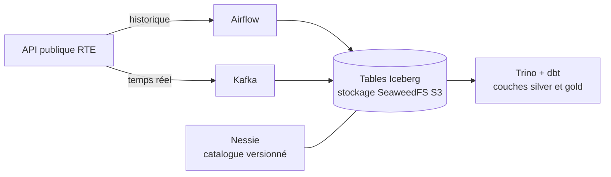

# WattLake

Plateforme Lakehouse open source construite sur les données publiques du mix électrique français (RTE, éCO2mix).

> **Projet en cours**, démarré en novembre 2026. La feuille de route ci-dessous indique ce qui fonctionne déjà et ce qui reste à construire.

## Pourquoi ce projet

WattLake est un projet d'apprentissage : je l'ai lancé pour pratiquer, de bout en bout, une stack Lakehouse moderne (Iceberg, Nessie, Trino, Airflow, Kafka) déployée sur Kubernetes selon des pratiques DataOps.

J'ai choisi les données de production et de consommation électrique parce qu'elles réunissent deux usages classiques : un historique à charger en batch, et des mises à jour fréquentes qui se prêtent à un flux temps réel. Elles permettent aussi de répondre à des questions concrètes, comme l'évolution de la part des énergies renouvelables dans le mix.

## Architecture



Toute la stack tourne sur un cluster Kubernetes local (k3d), déployée avec Helm et, à terme, synchronisée depuis ce dépôt par Argo CD.

| Brique | Outil | Rôle |
| --- | --- | --- |
| Stockage objet | SeaweedFS (API S3) | Stocke les fichiers Parquet des tables |
| Format de table | Apache Iceberg | Organise les fichiers en tables (schéma, partitions, snapshots) |
| Catalogue | Nessie | Versionne l'état des tables, avec des branches comme Git |
| Moteur de requêtes | Trino | Exécute le SQL sur les tables Iceberg |
| Transformations | dbt (adaptateur Trino) | Construit les couches silver et gold, avec des tests |
| Orchestration | Airflow | Planifie l'ingestion batch |
| Streaming | Kafka | Transporte les mises à jour en temps réel |
| Déploiement | Kubernetes, Helm, Argo CD, GitLab CI | Rend la stack reproductible et déployée en GitOps |

## Feuille de route

**Étape 1 : le socle**
- [x] Création du dépôt et de la documentation
- [x] Cluster k3d et déploiement de SeaweedFS, Nessie et Trino via Helm
- [x] Première table Iceberg créée depuis Trino et visible dans Nessie
- [ ] DAG Airflow chargeant l'historique dans la couche bronze

**Étape 2 : les transformations**
- [ ] Couches silver et gold avec dbt-trino
- [ ] Tests de qualité des données dans dbt

**Étape 3 : DataOps**
- [ ] Intégration continue (choix documenté dans l'ADR 003) : lint, tests Python, tests dbt, construction des images
- [ ] Déploiement GitOps avec Argo CD
- [ ] Write-Audit-Publish : écriture sur une branche Nessie, contrôles qualité, puis fusion dans `main`
- [ ] Identifiants déplacés dans des Secrets Kubernetes

**Étape 4 : temps réel et observabilité**
- [ ] Flux temps réel : API, Kafka, Iceberg
- [ ] Métriques et logs des traitements

## Démarrer

### Prérequis

| Outil | Version testée | Rôle |
| --- | --- | --- |
| Docker | 28.1 | Fait tourner les nœuds du cluster k3d |
| k3d | 5.9 (k3s 1.35.5) | Crée le cluster Kubernetes local |
| kubectl | 1.35 | Pilote le cluster |
| Helm | 3.12 | Déploie les composants de la stack |
| Python | 3.12 | Utilisé par le smoke test |
| direnv | 2.32 | Charge les variables d'environnement du projet (optionnel) |

Prévoir 8 Go de mémoire libre : les limites mémoire des composants atteignent environ 7 Go, dont 5 Go pour Trino.

### Isoler l'environnement du projet

Le projet utilise son propre fichier kubeconfig et sa propre configuration Helm, pour ne jamais toucher à un autre cluster. Le Makefile vérifie ces variables et refuse de s'exécuter si elles ne sont pas définies.

```bash
cp .envrc.example .envrc
direnv allow
```

Sans direnv, exporter à la main les quatre variables de [`.envrc.example`](.envrc.example) dans le terminal.

### Lancer la stack

```bash
make cluster-up      # cluster k3d : 1 serveur, 1 agent
make seaweedfs-up    # stockage objet S3, bucket warehouse
make nessie-up       # catalogue Nessie
make trino-up        # Trino, catalogue iceberg branché sur Nessie et SeaweedFS
make smoke-test      # test de bout en bout
```

Chaque cible `*-up` peut être relancée : elle installe le composant ou le met à jour.

Le smoke test crée une table Iceberg depuis Trino, la relit, vérifie que ses fichiers sont dans SeaweedFS et que son commit apparaît dans Nessie. Il se termine par :

```
==> Smoke test passed
```

### Interroger la stack

```bash
# CLI Trino, depuis le pod coordinator
kubectl --context k3d-wattlake -n wattlake exec -it deploy/trino-coordinator -- trino

# Interfaces web, chacune dans son terminal
kubectl --context k3d-wattlake -n wattlake port-forward svc/trino 8080:8080     # Trino : http://127.0.0.1:8080
kubectl --context k3d-wattlake -n wattlake port-forward svc/nessie 19120:19120  # Nessie : http://127.0.0.1:19120
```

### Mettre en pause et supprimer

```bash
make cluster-stop    # arrête les conteneurs du cluster, les données sont conservées
make cluster-start   # redémarre le cluster
make cluster-down    # supprime le cluster et toutes ses données
```

Nessie conserve pour l'instant son historique en mémoire : tout redémarrage de son pod efface les commits, alors que les fichiers restent dans SeaweedFS. Un stockage persistant est prévu dans la feuille de route.

## Choix techniques

Chaque décision importante est documentée dans un ADR (Architecture Decision Record), dans le dossier [`docs/adr`](docs/adr) :

- [ADR 001 : choix du stockage objet](docs/adr/001-stockage-objet.md), ou pourquoi SeaweedFS plutôt que MinIO.
- [ADR 002 : API utilisée pour accéder au catalogue Nessie](docs/adr/002-api-catalogue-nessie.md), ou pourquoi l'API native de Nessie plutôt que son catalogue REST Iceberg.

## Ce que je ferais en production

Ce projet tourne en local, avec des choix simplifiés. Sur une plateforme en production, je prévoirais en plus :

- un stockage persistant pour Nessie (PostgreSQL), au lieu du stockage en mémoire utilisé pour démarrer ;
- une gestion des secrets centralisée, par exemple avec un coffre-fort de secrets ;
- de la haute disponibilité sur le stockage objet et sur le coordinateur Trino ;
- de la supervision et des alertes sur la fraîcheur et la qualité des données.

## Auteure

Maëva Rodrigues, Data Engineer.
