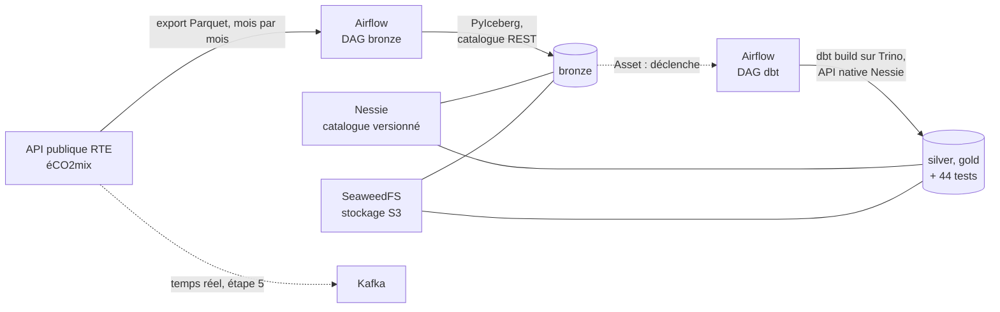

# WattLake

[](https://github.com/Maeva-RODRIGUES/wattlake/actions/workflows/ci.yml)

Plateforme Lakehouse open source construite sur les données publiques du mix électrique français (RTE, éCO2mix).

> **Projet en cours**, démarré en novembre 2026. La feuille de route ci-dessous indique ce qui fonctionne déjà et ce qui reste à construire.

## Pourquoi ce projet

WattLake est un projet d'apprentissage : je l'ai lancé pour pratiquer, de bout en bout, une stack Lakehouse moderne (Iceberg, Nessie, Trino, Airflow, Kafka) déployée sur Kubernetes selon des pratiques DataOps.

J'ai choisi les données de production et de consommation électrique parce qu'elles réunissent deux usages classiques : un historique à charger en batch, et des mises à jour fréquentes qui se prêtent à un flux temps réel. Elles permettent aussi de répondre à des questions concrètes, comme l'évolution de la part des énergies renouvelables dans le mix.

## Aperçu


*Historique de la branche `main` dans Nessie après un smoke test. Chaque opération lancée depuis Trino (suppression, création du namespace, création de la table, insertion) devient un commit, comme dans Git. C'est ce versionnement qui permettra de revenir à un état antérieur et de travailler sur des branches isolées avant de publier.*


*Requête de contrôle du smoke test dans l'interface de Trino : elle relit la table Iceberg et appelle `fail()` si le contenu n'est pas celui attendu. Ses deux étapes terminées montrent que Trino lit bien les données via le catalogue Nessie et le stockage SeaweedFS.*

Ces captures sont générées par `make screenshots`.

## Architecture



Toute la stack tourne sur un cluster Kubernetes local (k3d), déployée avec Helm et, à terme, synchronisée depuis ce dépôt par Argo CD. Les tables sont au format Iceberg. Le DAG bronze charge l'historique par PyIceberg, puis chaque chargement déclenche le DAG dbt, qui reconstruit silver et gold sur Trino et lance les tests. Kafka, en pointillés, est prévu pour le temps réel.

| Brique | Outil | Rôle |
| --- | --- | --- |
| Stockage objet | SeaweedFS (API S3) | Stocke les fichiers Parquet des tables |
| Format de table | Apache Iceberg | Organise les fichiers en tables (schéma, partitions, snapshots) |
| Catalogue | Nessie | Versionne l'état des tables, avec des branches comme Git |
| Moteur de requêtes | Trino | Exécute le SQL sur les tables Iceberg |
| Ingestion | Python, PyIceberg | Télécharge les exports de l'API et les écrit dans bronze, un commit par mois |
| Transformations | dbt (adaptateur Trino) | Construit les couches silver et gold, avec des tests |
| Orchestration | Airflow | Planifie l'ingestion batch et lance dbt chaque fois que bronze change |
| Streaming | Kafka (à venir) | Transportera les mises à jour en temps réel |
| Intégration continue | GitHub Actions, Dependabot (ADR 005) | Vérifie le code à chaque modification et publie l'image Airflow |
| Déploiement | Kubernetes, Helm, Argo CD | Déploie la stack en GitOps : le cluster suit la branche `main` |

## Feuille de route

**Étape 1 : le socle**
- [x] Création du dépôt et de la documentation
- [x] Cluster k3d et déploiement de SeaweedFS, Nessie et Trino via Helm
- [x] Première table Iceberg créée depuis Trino et visible dans Nessie
- [x] DAG Airflow chargeant l'historique dans la couche bronze

**Étape 2 : les transformations**
- [x] Couches silver et gold avec dbt-trino
- [x] Tests de qualité des données dans dbt
- [x] dbt lancé par Airflow chaque fois que la couche bronze change

**Étape 3 : DataOps**
- [x] Intégration continue avec GitHub Actions (ADR 005) : lint, tests Python, validation dbt, construction et publication de l'image Airflow
- [x] Déploiement GitOps avec Argo CD
- [x] Identifiants déplacés dans des Secrets Kubernetes, générés hors du dépôt, avec une identité S3 par composant (ADR 006)
- [x] Catalogue Nessie persistant, stocké dans PostgreSQL (ADR 007)
- [x] Write-Audit-Publish : écriture sur une branche Nessie, contrôles qualité, puis fusion dans `main` (ADR 008)

**Étape 4 : temps réel et observabilité**
- [ ] Flux temps réel : API, Kafka, Iceberg
- [ ] Métriques et logs des traitements

## Démarrer

### Prérequis

| Outil | Version testée | Rôle |
| --- | --- | --- |
| Docker | 28.1 | Fait tourner les nœuds du cluster k3d et construit l'image Airflow |
| k3d | 5.9 (k3s 1.35.5) | Crée le cluster Kubernetes local |
| kubectl | 1.35 | Pilote le cluster |
| Helm | 3.12 | Déploie les composants de la stack |
| Python | 3.12 | Utilisé par le smoke test |
| uv | 0.11 | Crée les environnements Python 3.13 du code d'ingestion et du projet dbt |
| direnv | 2.32 | Charge les variables d'environnement du projet (optionnel) |

Prévoir 16 Go de mémoire libre : les limites mémoire des composants atteignent environ 13 Go, dont 5 Go pour Trino et 5,5 Go pour Airflow, et les Jobs d'installation d'Airflow ajoutent temporairement 2 Go.

### Isoler l'environnement du projet

Le projet utilise son propre fichier kubeconfig et sa propre configuration Helm, pour ne jamais toucher à un autre cluster. Le Makefile vérifie ces variables et refuse de s'exécuter si elles ne sont pas définies.

```bash
cp .envrc.example .envrc
direnv allow
```

Sans direnv, exporter à la main les quatre variables de [`.envrc.example`](.envrc.example) dans le terminal.

### Lancer la stack

```bash
make up                 # cluster k3d, Secrets, Argo CD, puis les Applications de la stack
make smoke-test         # test de bout en bout
make rest-catalog-test  # écriture PyIceberg par le catalogue REST, lue depuis Trino
make dbt ARGS="debug"   # projet dbt : configuration et connexion à Trino (voir transform/README.md)
```

`make up` crée le cluster et les Secrets de la stack, installe Argo CD, puis lui confie l'Application racine. Les identifiants (clés S3, mots de passe, clés d'Airflow) sont tirés au hasard sur le poste par `make secrets` : ils ne sont jamais écrits dans le dépôt (voir l'[ADR 006](docs/adr/006-gestion-des-secrets.md)). Argo CD déploie ensuite SeaweedFS, PostgreSQL, Nessie, Trino et Airflow depuis la branche `main` du dépôt, et les maintient synchronisés : un changement fait à la main dans le cluster est annulé (voir [infra/README.md](infra/README.md)). `make up` peut être relancé : il ne recrée pas le cluster existant.

### Déployer une modification

Le cluster suit la branche `main` : modifier un fichier de valeurs dans `infra/`, puis le pousser sur `main`, suffit à le déployer. Pour une nouvelle version de l'image Airflow (code d'ingestion, DAG ou projet dbt), attendre que la CI du commit sur `main` ait publié l'image, puis reporter son SHA dans `images.airflow.tag` de [infra/airflow/values.yaml](infra/airflow/values.yaml) et pousser ce changement.

### Interface d'Argo CD

```bash
kubectl --context k3d-wattlake -n argocd port-forward svc/argocd-server 8082:80   # http://127.0.0.1:8082
kubectl --context k3d-wattlake -n argocd get secret argocd-initial-admin-secret \
  -o jsonpath='{.data.password}' | base64 --decode                                 # mot de passe de « admin »
```

Le mot de passe initial est généré par Argo CD à l'installation : il n'est pas dans le dépôt.

`make rest-catalog-test` vérifie le chemin d'écriture de l'ingestion (voir l'[ADR 004](docs/adr/004-catalogue-rest-ingestion.md)) : depuis un pod éphémère, PyIceberg crée une table par le catalogue REST de Nessie, y ajoute des lignes puis en remplace une partie. Trino relit ensuite la table par l'API native, et Nessie doit montrer un commit par écriture.

Le smoke test crée une table Iceberg depuis Trino, la relit, vérifie que ses fichiers sont dans SeaweedFS et que son commit apparaît dans Nessie. Il se termine par :

```
==> Smoke test passed
```

### Charger les données et lancer les transformations

Sur un cluster neuf, les deux DAG d'Airflow sont en pause, comme tout nouveau DAG. Les activer lance la chaîne complète :

```bash
kubectl --context k3d-wattlake -n wattlake exec airflow-scheduler-0 -c scheduler -- \
  airflow dags unpause dbt_transformations
kubectl --context k3d-wattlake -n wattlake exec airflow-scheduler-0 -c scheduler -- \
  airflow dags unpause eco2mix_history_to_bronze
```

Le DAG `eco2mix_history_to_bronze` rattrape alors l'historique mois par mois depuis janvier 2012, en quelques minutes. Chaque mois chargé met à jour l'Asset de la table bronze, ce qui déclenche `dbt_transformations` : silver et gold sont reconstruites et les tests lancés. Les détails sont dans [ingestion/README.md](ingestion/README.md) et [transform/README.md](transform/README.md).

### Interroger la stack

```bash
# CLI Trino, depuis le pod coordinator
kubectl --context k3d-wattlake -n wattlake exec -it deploy/trino-coordinator -- trino

# Interfaces web, chacune dans son terminal
kubectl --context k3d-wattlake -n wattlake port-forward svc/trino 8080:8080     # Trino : http://127.0.0.1:8080
kubectl --context k3d-wattlake -n wattlake port-forward svc/nessie 19120:19120  # Nessie : http://127.0.0.1:19120
kubectl --context k3d-wattlake -n wattlake port-forward svc/airflow-api-server 8081:8080  # Airflow : http://127.0.0.1:8081

# Mot de passe de l'utilisateur « admin » d'Airflow
kubectl --context k3d-wattlake -n wattlake get secret airflow-credentials \
  -o jsonpath='{.data.admin-password}' | base64 --decode
```

Une fois la chaîne passée, la part des renouvelables se lit dans la couche gold :

```sql
SELECT year(month) AS annee,
       round(sum(renewable_strict_mwh) / sum(production_with_detail_mwh), 3) AS part_renouvelable
FROM iceberg.gold.renewable_share_monthly
GROUP BY 1 ORDER BY 1;
```

### Régénérer les captures

```bash
make screenshots     # smoke test, puis captures de Nessie et Trino dans docs/images/
```

Au premier lancement, la cible crée un environnement virtuel `.venv` dans le projet et y installe Playwright et un Chromium headless (environ 450 Mo). Rien n'est installé en dehors du projet : supprimer `.venv` suffit à tout retirer.

### Intégration continue

Le workflow [`.github/workflows/ci.yml`](.github/workflows/ci.yml) tourne sur chaque pull request et chaque push sur `main`. Ses quatre jobs appellent les mêmes cibles qu'en local :

```bash
make lint             # ruff : style et erreurs du code Python (configuration : ruff.toml)
make ingestion-test   # tests unitaires de l'ingestion, sans réseau
make dbt-parse        # validation du projet dbt, sans base de données
make airflow-image    # construction de l'image Airflow
```

Sur `main`, l'image est publiée sur `ghcr.io/maeva-rodrigues/wattlake-airflow`, avec le SHA du commit comme tag. Les actions tierces sont épinglées par SHA, et les permissions réduites au minimum.

`dbt build` et les tests unitaires dbt ne tournent pas en CI : ils demandent Trino et la table bronze. Ils tournent dans le cluster, avec `make dbt ARGS="build"` ou le DAG `dbt_transformations`.

### Mettre à jour les versions

Dependabot ([`.github/dependabot.yml`](.github/dependabot.yml)) propose chaque semaine les mises à jour des actions et des dépendances propres à l'ingestion (PyIceberg, pytest, respx), avec un délai de 14 jours après publication (règle des deux semaines). Les mises à jour de sécurité ne sont pas retardées.

Le reste se met à jour à la main, en vérifiant que chaque version a au moins deux semaines :

- **Airflow et les paquets épinglés sur ses contraintes** (`httpx`, `pyarrow`, `s3fs`, `sqlalchemy`), que Dependabot ignore : une autre version de ces paquets est impossible à installer avec les contraintes d'Airflow 3.2.2, et la CI le refuse. Monter de version Airflow change ensemble l'image de base et `apache-airflow==` dans [`ingestion/Dockerfile`](ingestion/Dockerfile), l'URL des contraintes (Dockerfile, Makefile et [`tests/catalog/run.sh`](tests/catalog/run.sh)), `airflowVersion` dans [`infra/airflow/values.yaml`](infra/airflow/values.yaml), le chart, puis ces paquets ;
- les charts Helm et la version de Python, dans le [`Makefile`](Makefile) ;
- les tags d'images dans les fichiers de valeurs de [`infra/`](infra/) ;
- les dépendances de dbt : modifier [`transform/requirements.in`](transform/requirements.in), puis `make transform-lock`, qui régénère `requirements.txt` en ignorant les versions de moins de 14 jours.

### Mettre en pause et supprimer

```bash
make cluster-stop    # arrête les conteneurs du cluster, les données sont conservées
make cluster-start   # redémarre le cluster
make cluster-restart # arrête puis redémarre le cluster (après un changement de réseau, voir infra/README.md)
make down            # supprime le cluster et toutes ses données (alias de cluster-down)
```

Le catalogue de Nessie (branches, commits, emplacement des tables) est stocké dans PostgreSQL : il survit au redémarrage de Nessie et à `make cluster-stop`, mais pas à `make down`, qui supprime aussi les volumes.

## Choix techniques

Chaque décision importante est documentée dans un ADR (Architecture Decision Record), dans le dossier [`docs/adr`](docs/adr) :

- [ADR 001 : choix du stockage objet](docs/adr/001-stockage-objet.md), ou pourquoi SeaweedFS plutôt que MinIO.
- [ADR 002 : API utilisée pour accéder au catalogue Nessie](docs/adr/002-api-catalogue-nessie.md), ou pourquoi l'API native de Nessie plutôt que son catalogue REST Iceberg.
- [ADR 003 : base de métadonnées d'Airflow](docs/adr/003-base-metadonnees-airflow.md), ou pourquoi une image PostgreSQL officielle plutôt que celle embarquée par le chart.
- [ADR 004 : catalogue REST Iceberg pour l'ingestion](docs/adr/004-catalogue-rest-ingestion.md), qui remplace l'ADR 002 : pourquoi PyIceberg écrit par le catalogue REST de Nessie avec ses propres clés S3, pendant que Trino reste sur l'API native.
- [ADR 005 : plateforme d'intégration continue](docs/adr/005-integration-continue.md), ou pourquoi GitHub Actions plutôt que GitLab CI, dont la CI pour un dépôt GitHub est réservée aux offres payantes.
- [ADR 006 : gestion des secrets](docs/adr/006-gestion-des-secrets.md), ou pourquoi des Secrets générés hors du dépôt plutôt que Sealed Secrets, SOPS ou External Secrets, sur un cluster local recréé à volonté.
- [ADR 007 : stockage des versions de Nessie](docs/adr/007-stockage-versions-nessie.md), ou pourquoi JDBC2 sur l'instance PostgreSQL existante plutôt que RocksDB ou une instance dédiée.

## Ce que je ferais en production

Ce projet tourne en local, avec des choix simplifiés. Sur une plateforme en production, je prévoirais en plus :

- une base PostgreSQL gérée, avec haute disponibilité et sauvegardes, pour Airflow et Nessie, voire une instance par composant (voir l'ADR 007) ;
- une gestion des secrets centralisée : External Secrets et le gestionnaire de secrets du cloud, à la place de `make secrets` (voir l'ADR 006) ;
- de la haute disponibilité sur le stockage objet et sur le coordinateur Trino ;
- de la supervision et des alertes sur la fraîcheur et la qualité des données.

## Auteure

Maëva Rodrigues, Data Engineer.
