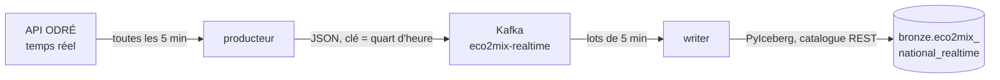

# streaming

Flux temps réel, en deux composants qui tournent dans la même image :

- le **producteur** interroge le jeu éCO2mix temps réel (`eco2mix-national-tr`) et publie ses mesures dans le topic Kafka `eco2mix-realtime` ([ADR 009](../docs/adr/009-producteur-temps-reel.md)) ;
- le **writer** lit ce topic et ajoute ses messages à la table Iceberg `bronze.eco2mix_national_realtime` ([ADR 010](../docs/adr/010-ecriture-flux-iceberg.md)).



## Producteur

Le producteur tourne en continu dans un `Deployment` à un réplica ([infra/streaming/](../infra/streaming/)). Toutes les 5 minutes :

1. il lit la date de rafraîchissement du jeu (`data_processed`) ; si elle n'a pas changé, il attend le cycle suivant ;
2. sinon, il exporte les lignes mesurées depuis son curseur moins 3 heures, pour republier les valeurs que RTE a pu réviser ;
3. il les publie, de la plus ancienne à la plus récente, et attend que Kafka les ait toutes acceptées ;
4. il avance son curseur au dernier quart d'heure publié.

Le curseur n'est stocké nulle part ailleurs que dans Kafka : au démarrage, c'est la clé du dernier message du topic. Le topic vide, le producteur publie tout le jeu, depuis le 1ᵉʳ septembre.

Si l'API ne répond pas, après 5 tentatives espacées, le cycle est sauté et le suivant rattrape tout. Une erreur de Kafka arrête le processus : Kubernetes le redémarre, et il reprend depuis le topic.

| Module | Rôle |
| --- | --- |
| `odre.py` | Client de l'API ODRÉ, avec nouvelles tentatives sur les erreurs passagères |
| `messages.py` | Format des messages (clé, enveloppe JSON) |
| `kafka.py` | Publication avec accusés de réception, lecture du dernier message du topic |
| `producer.py` | Boucle, configuration, arrêt propre sur SIGTERM |
| `health.py` | Sonde de vie, commune aux deux composants : échoue si le fichier de heartbeat a plus de 15 minutes |

## Writer

Le writer tourne en continu dans son propre `Deployment` à un réplica. En boucle :

1. il collecte les messages pendant 5 minutes au plus (10 000 messages au plus) ;
2. s'il en a reçu, il les ajoute à la table en un seul commit Iceberg, avec, dans le résumé du snapshot, l'offset suivant de chaque partition (`wattlake.kafka.next-offsets`) ;
3. il commite aussi ces offsets dans le groupe Kafka `wattlake-writer`, pour la supervision seulement.

Au démarrage, il reprend aux offsets lus dans la table, jamais dans Kafka : données et offsets avancent dans le même commit, ce qui donne une écriture exactement une fois. Si le dernier commit sur la table ne vient pas du writer (une maintenance, par exemple), il les recalcule à partir de la colonne `_kafka_offset` : par Nessie, une table n'expose que son snapshot courant.

La table est en ajout seul : chaque message devient une ligne, avec les 41 champs de l'API tels quels et des colonnes techniques (`_source_dataset`, `_source_updated_at`, `_kafka_partition`, `_kafka_offset`, `_ingested_at`). Un même quart d'heure y figure une fois par version publiée ; la dernière version est celle au `_source_updated_at` le plus récent. Un message au format inattendu arrête le writer, plutôt que de perdre ou d'ajouter des données en silence.

| Module | Rôle |
| --- | --- |
| `bronze.py` | Schéma de la table, conversion des messages, offsets stockés dans les snapshots |
| `writer.py` | Boucle, lots, configuration, arrêt propre sur SIGTERM |

## Format des messages

- **Topic** : `eco2mix-realtime`, une partition, compacté ([infra/kafka/topics.yaml](../infra/kafka/topics.yaml)).
- **Clé** : le quart d'heure, `date_heure` tel que publié par l'API, en UTC : `2026-11-11T16:00:00+00:00`.
- **Valeur** : du JSON en UTF-8.

```json
{
  "dataset": "eco2mix-national-tr",
  "source_updated_at": "2026-11-11T17:00:14+00:00",
  "record": {"date_heure": "2026-11-11T16:00:00+00:00", "consommation": 47025, "nucleaire": 42257, "...": "..."}
}
```

`record` est la ligne de l'API sans aucune modification : noms et types des champs compris, y compris les nombres typés en texte (voir [docs/sources.md](../docs/sources.md)). `source_updated_at` est la date de rafraîchissement du jeu au moment de la lecture.

Un même quart d'heure peut arriver plusieurs fois : le consommateur garde la version au `source_updated_at` le plus récent. Grâce à la compaction, Kafka finit par ne garder que la dernière version de chaque clé.

## Configuration

Variables d'environnement, avec leur valeur par défaut :

| Variable | Composant | Défaut | Rôle |
| --- | --- | --- | --- |
| `KAFKA_BOOTSTRAP_SERVERS` | les deux | `wattlake-kafka-bootstrap:9092` | Adresse de Kafka |
| `KAFKA_TOPIC` | les deux | `eco2mix-realtime` | Topic du flux |
| `HEARTBEAT_FILE` | les deux | `/tmp/heartbeat` | Fichier touché à chaque cycle, lu par la sonde de vie |
| `POLL_INTERVAL_SECONDS` | producteur | `300` | Intervalle entre deux cycles |
| `OVERLAP_HOURS` | producteur | `3` | Fenêtre republiée à chaque rafraîchissement |
| `ICEBERG_TABLE` | writer | `bronze.eco2mix_national_realtime` | Table de destination |
| `BATCH_INTERVAL_SECONDS` | writer | `300` | Durée maximale d'un lot |
| `MAX_BATCH_MESSAGES` | writer | `10000` | Taille maximale d'un lot |
| `PYICEBERG_CATALOG__WATTLAKE__*` | writer | | Catalogue REST de Nessie et clés S3 de l'identité `streaming` |

## Commandes

```bash
make streaming-test          # tests unitaires, sans réseau (API et Kafka simulés, catalogue Iceberg SQLite local)
make streaming-lock          # régénère requirements.txt et requirements-test.txt
make streaming-image         # construit l'image wattlake-streaming:local
make streaming-image-import  # charge cette image dans les nœuds k3d
```

Les dépendances sont déclarées dans `pyproject.toml`, puis figées avec leurs empreintes (hashes) par `make streaming-lock`, qui ignore les versions de moins de 14 jours. L'image installe `requirements.txt` avec `--require-hashes`.

Suivre les deux composants et lire le topic :

```bash
kubectl --context k3d-wattlake -n wattlake logs deploy/producer -f
kubectl --context k3d-wattlake -n wattlake logs deploy/writer -f
kubectl --context k3d-wattlake -n wattlake exec wattlake-dual-role-0 -- \
  /opt/kafka/bin/kafka-console-consumer.sh --bootstrap-server localhost:9092 \
  --topic eco2mix-realtime --from-beginning --max-messages 3 --formatter-property print.key=true
```
